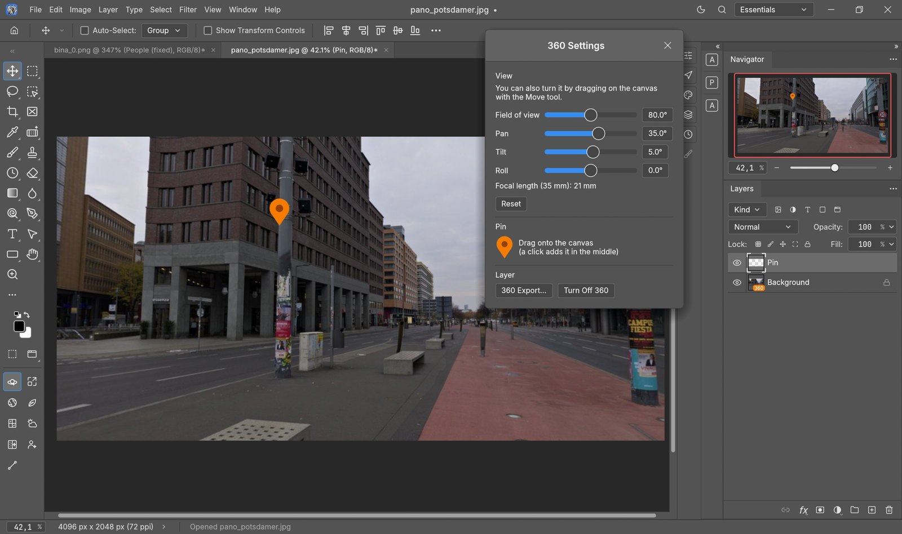
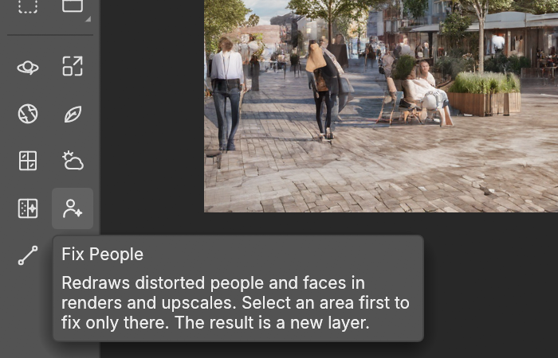
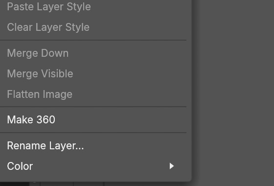
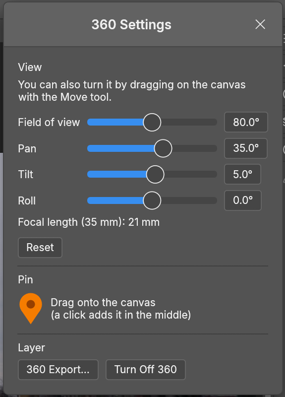
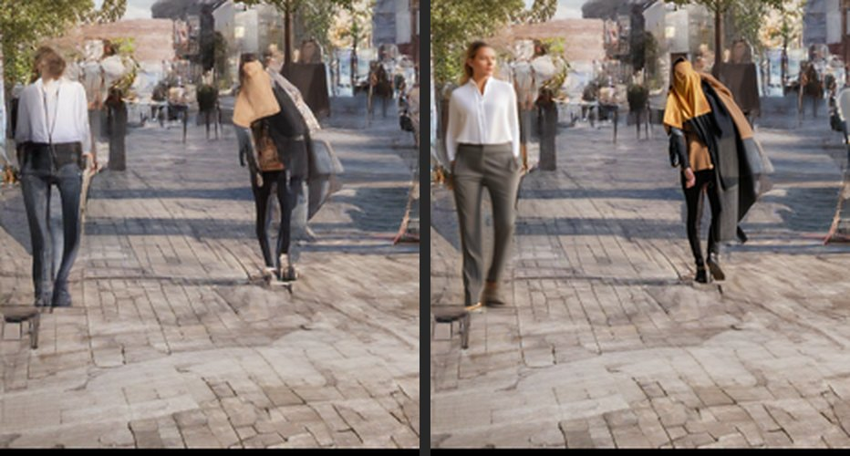
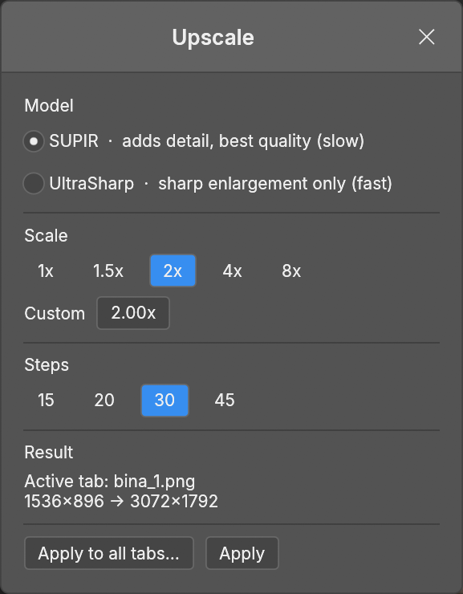
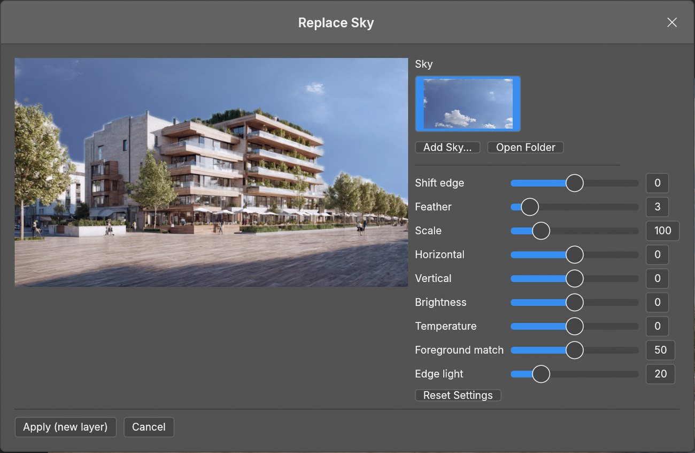
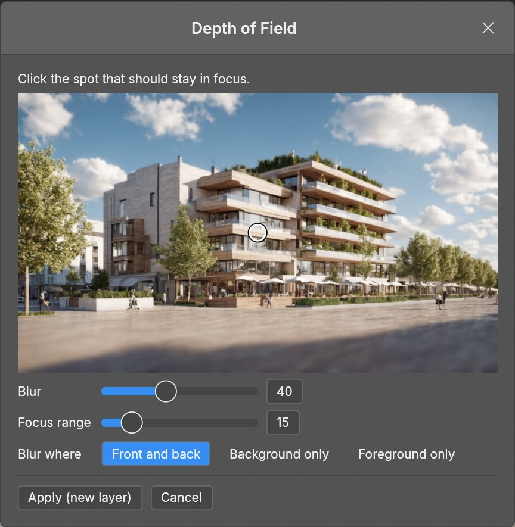
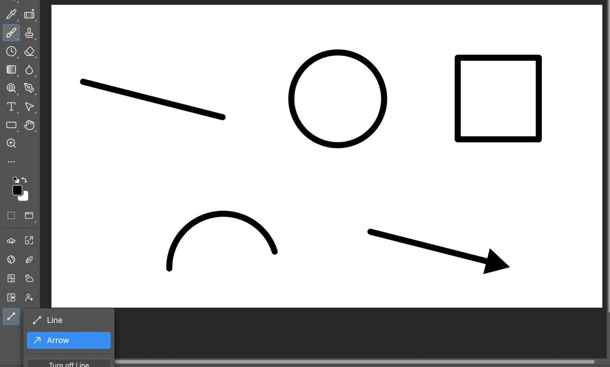
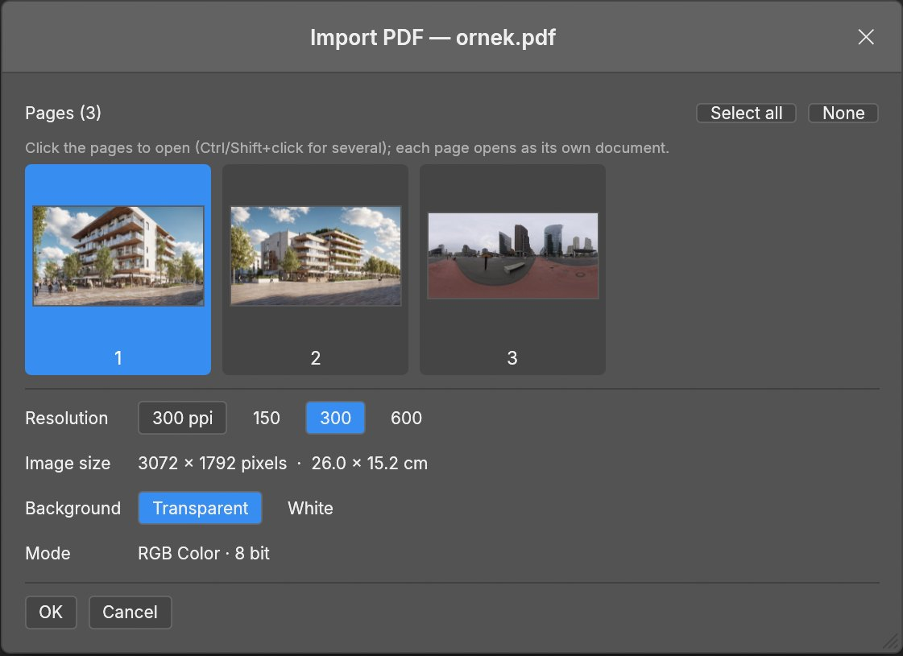

<h1 align="center">PhotoCraft Evren</h1>

<p align="center">
  <b>PhotoCraft with add-ons for architectural visualization:</b><br>
  360° panorama layers · AI upscale · fix distorted people · AI denoise · depth of field ·<br>
  sky replacement · plant and glass separation · PDF import · Procreate-style line tool
</p>

<p align="center">
  <a href="README.tr.md">Türkçe</a> ·
  <a href="#install">Install</a> ·
  <a href="#the-add-ons">Add-ons</a> ·
  <a href="#working-with-360-panoramas">360 guide</a> ·
  <a href="https://github.com/evrenot3d/photocraft/issues">Report a problem</a>
</p>



**PhotoCraft Evren** is a fork of [PhotoCraft](https://github.com/storytold/photocraft), the open-source,
Photoshop-style image editor written in pure Rust by the ArtCraft team and community. It keeps everything
PhotoCraft does (layers, masks, adjustment layers, layer styles, type, vectors, brushes, real PSD files) and
adds a set of tools made for architectural renders, drone photos and 360° panoramas.

The add-ons live at the **bottom of the left toolbar**. Hover any button for a short description; drag the
buttons to reorder them. They follow PhotoCraft's interface language: Turkish in a Turkish interface, English
everywhere else.

> [!NOTE]
> PhotoCraft Evren is an independent fork. It is not made, sponsored or endorsed by the ArtCraft Team.
> Windows 10 / 11 (x64). The AI tools need an NVIDIA graphics card (8 GB or more recommended).

<p align="center"></p>

## The add-ons

| Add-on | What it does | Needs the AI setup |
|---|---|---|
| **360 Settings** | 360° panorama layers you can look around in, map pin, 360 Export | no |
| **Upscale** | SUPIR or 4x-UltraSharp, 1–8×, on one or all open tabs | yes |
| **Depth of Field** | Lens blur from an AI depth map | yes |
| **Separate Plants** | Trees and plants to their own layer | yes |
| **Separate Glass** | Windows and glass to their own layer | yes |
| **Replace Sky** | New sky with edge and color matching | yes |
| **Denoise** | Render noise removal on the graphics card | the denoiser only |
| **Fix People** | Redraws distorted people and faces | yes |
| **Line / Arrow** | Draw, hold, and the stroke snaps to a clean shape | no |
| **Import PDF** | Open PDF pages like Photoshop | no |
| **Scroll-wheel zoom** | Ctrl / Alt + wheel zoom too | no |

### 360° panorama layers

Turn any equirectangular panorama (a DJI drone 360 photo, a Ricoh Theta / Insta360 shot, a V-Ray or Corona
360 render) into a layer you can **look around in**, edit like a normal photo, and save back as a full 360°
sphere. See the [step-by-step 360 guide](#working-with-360-panoramas) below.

<p>
  
  
</p>

- **Make 360**: right-click a layer in the Layers panel. The layer becomes a perspective view of the sphere and
  gets an orange **360** badge.
- **Look around**: with the **Move tool**, drag on the canvas, or use the sliders in **360 Settings**
  (field of view, pan, tilt, roll; the 35 mm focal length is shown).
- **Edit the whole sphere**: filters (Camera Raw and the others) and adjustments applied to a 360 layer are
  applied to the entire sphere, so they stay when you turn the view.
- **Paint and merge into the sphere**: put anything on a layer above (a logo, a person, a retouch) and use
  Merge Down: it is projected onto the sphere and turns with it.
- **Map pin**: drag the orange pin from 360 Settings onto the canvas to mark a place.
- **360 Export…** (File › Export, or the 360 Settings window) saves the whole sphere as an equirectangular
  JPG / PNG / TIFF. A JPG keeps the original EXIF (camera, GPS) and gets Google Photo Sphere (GPano) XMP, so
  Facebook, Google Photos, Kuula and other 360 viewers show it as a 360 photo, like the camera's original.

### Fix People

<p></p>

AI renders and upscales often turn small, distant people into melted figures with broken faces. **Fix People**
finds every person (the image is scanned in tiles, so far-away people are found too), enlarges each one, and
redraws it at full strength with Juggernaut XL while a **depth ControlNet keeps the pose and position**. Every
visible face is then enlarged again and redrawn from scratch. People seen from behind get no invented face.

- Select an area first (for example with the Rectangular Marquee) to fix **only that area**; with no
  selection the whole image is processed.
- The result arrives as a new layer, **People (fixed)**, containing only the redrawn people: hide it to
  compare, or erase anyone you prefer as before.
- People taller than 640 px (close to the camera) are left alone; they are rarely distorted.

### Upscale

<p></p>

- **SUPIR** (with Juggernaut XL) adds real detail; **4x-UltraSharp** is a fast, sharp enlargement.
- 1×, 1.5×, 2×, 4×, 8× or any custom factor up to 8×; 15–45 steps for SUPIR.
- **Apply to all tabs…** upscales every open document one after another.
- The canvas grows to the new size and the result is a new layer on top.

### Denoise

Removes render noise from the **selected layer**, like the denoiser in Corona or V-Ray, using
[Intel Open Image Denoise](https://github.com/RenderKit/oidn) on the graphics card (CUDA) or the processor.
The window updates the layer live: **Amount** (mix with the original), **Sharpness**, **Quality**
(fast / balanced / high) and a **Preview** switch for before / after. Cancel restores the layer.

### Replace Sky

<p></p>

Finds the sky (SegFormer) and replaces it with one from your sky library, with a live preview and controls for
edge shift, feather, scale, position, brightness, temperature, **foreground match** (the building takes the
new sky's light) and **edge light**. Add your own sky photos with **Add Sky…**. The result is a new layer.

### Depth of Field

<p></p>

Depth Anything V2 estimates the depth of the image; click the spot that should stay sharp and choose how much
blur, how deep the sharp zone is, and whether the front, the back or both get blurred.

### Separate Plants / Separate Glass

One click copies all trees, grass and plants (or all windows and glass) to a new transparent layer, ready for
color grading, reflections or replacement.

### Line / Arrow (QuickShape)

<p></p>

Like Procreate's QuickShape. Click the button and choose **Line** or **Arrow**. Draw freely, then **keep the
button pressed and hold still for half a second**: the stroke snaps into a perfect straight line (exactly
horizontal / vertical when close), circle or ellipse, square or rectangle, triangle or polygon, sharp-cornered
polyline, arc or smooth curve. After a line snaps you can still drag its end. **Arrow** adds an arrowhead at
the end. Thickness is the brush size (right-click on the canvas), the color is the foreground color. Each
stroke is one undo step.

### Import PDF

<p></p>

Open a PDF with File › Open, a double-click or drag and drop: pick the pages (Ctrl / Shift for several), the
resolution (150 / 300 / 600 ppi or any value) and a transparent or white background. Each page opens as its
own document. Plans and line drawings come out crisp, ready to color. Uses Windows' built-in PDF engine.

### Scroll-wheel zoom

With PhotoCraft's *Zoom with Scroll Wheel* preference on (Edit › Preferences › General), **Ctrl + wheel** and
**Alt + wheel** zoom as well, instead of scrolling sideways or up and down.

## Working with 360 panoramas

1. **Open** an equirectangular panorama (2:1, for example 8192×4096). DJI Mini / Air / Mavic "Sphere" photos,
   360 camera photos and 360 renders all work.
2. In the **Layers** panel, right-click the layer and choose **Make 360**. The 360 Settings window opens and the
   layer gets an orange **360** badge.
3. **Look around**: choose the **Move tool** (V) and drag on the canvas, or use **Field of view**, **Pan**,
   **Tilt** and **Roll** in 360 Settings. **Reset** returns to the front view.
4. **Edit** as usual:
   - Filters and adjustments on the 360 layer (Filter › Camera Raw, Image › Adjustments…) apply to the
     **whole sphere**, so turning the view never loses them.
   - To add or retouch something, work on a **new layer above** the 360 layer (paint, clone, place an image),
     then **Layer › Merge Down**: it is baked into the sphere at that spot and turns with it.
   - Drag the orange **pin** onto the canvas to mark a place; merge it down to keep it in the sphere.
5. **Save the 360**: **File › Export › 360 Export…** (or the button in 360 Settings). Choose JPG to keep the
   camera's EXIF / GPS and get 360 (GPano) metadata, so 360 viewers recognise it. PNG and TIFF also work.
6. To get the flat panorama back as a normal layer, use **Turn Off 360**.

Saving the document as **.pcraft** or **.psd** keeps the 360 layer, its full sphere and its view; reopen it and
keep turning.

## Install

### The editor

Build from source (Windows, [Rust](https://rustup.rs) and the Visual Studio C++ Build Tools):

```powershell
git clone https://github.com/evrenot3d/photocraft.git
cd photocraft
git checkout evren
cargo build --release -p photocraft
.\target\release\photocraft.exe
```

The 360, PDF, Line and scroll-wheel add-ons work right away.

### The AI tools

The AI tools run [ComfyUI](https://github.com/comfyanonymous/ComfyUI) and a few vision models in a separate
Python process that starts only while a tool works and closes when it finishes. Install them once:

```powershell
cd evren_ai
powershell -ExecutionPolicy Bypass -File install.ps1
```

Requirements: an NVIDIA graphics card (RTX, 8 GB or more recommended), [Python 3.11](https://www.python.org/downloads/release/python-3119/),
[Git](https://git-scm.com/download/win) and about **35 GB** of free space (≈22 GB of models). The script can be run
again to resume. The models and their licenses are listed in [evren_ai/MODELS.md](evren_ai/MODELS.md): several are
**for non-commercial use only**.

## Keeping up with PhotoCraft

The add-ons live in their own files (`crates/ui-egui/src/evren/`, `crates/engine/src/cmd/evren_*_cmds.rs`,
`evren_ai/`) and connect to PhotoCraft through a few one-line hooks marked `EVREN eklentisi`, so new PhotoCraft
releases can be merged in (`EVREN_guncelle.ps1`). The in-app update check follows **this** fork's releases, so an
official PhotoCraft update never replaces the add-ons.

## License and credits

- PhotoCraft Evren is licensed like PhotoCraft: **MIT OR Apache-2.0** ([LICENSE-MIT](LICENSE-MIT),
  [LICENSE-APACHE](LICENSE-APACHE), [NOTICE](NOTICE)).
- Based on [PhotoCraft](https://github.com/storytold/photocraft) by the ArtCraft team and community. The ArtCraft
  name and logos are trademarks of the ArtCraft Team; as their terms require, the logos are removed from this fork.
  The original README is kept in [docs/PHOTOCRAFT_README.md](docs/PHOTOCRAFT_README.md).
- The AI models keep their own licenses: [evren_ai/MODELS.md](evren_ai/MODELS.md).
- Screenshots: the 360 panorama ([Potsdamer Platz](https://polyhaven.com/a/potsdamer_platz), Greg Zaal) and the sky
  ([Kloofendal 48d Partly Cloudy](https://polyhaven.com/a/kloofendal_48d_partly_cloudy_puresky), Greg Zaal and Jarod
  Guest) are from Poly Haven (CC0); the building images were generated for this page.
- Adobe and Photoshop are trademarks of Adobe Inc.; this project is not affiliated with Adobe.
