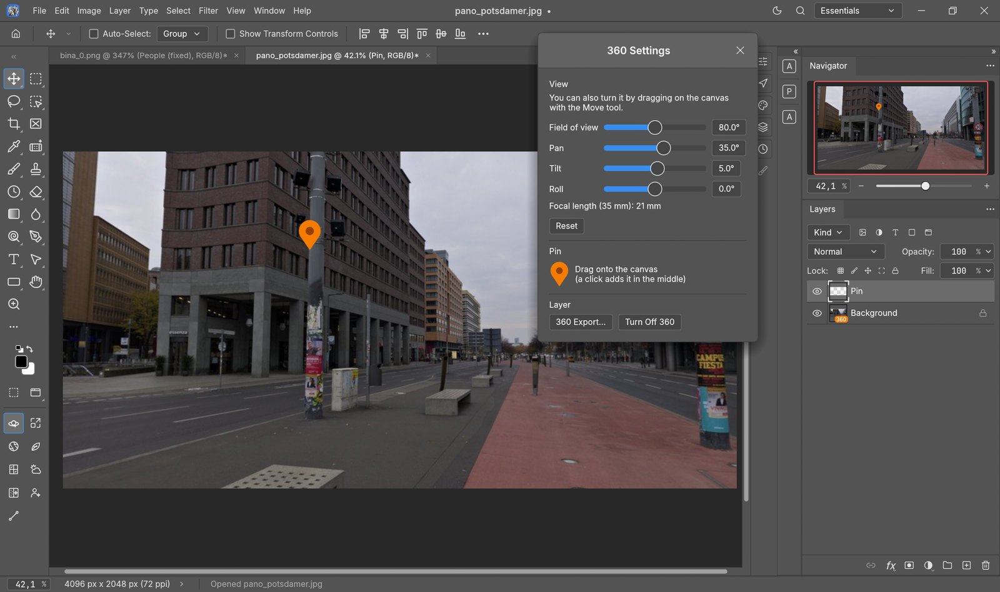

<h1 align="center">PhotoCraft Evren</h1>

<p align="center">
  <b>Mimari görselleştirme eklentileriyle PhotoCraft:</b><br>
  360° panorama katmanları · yapay zekâ ile büyütme · bozuk insanları düzeltme · gürültü temizleme ·<br>
  alan derinliği · gökyüzü değiştirme · bitki ve cam ayırma · PDF açma · Procreate tarzı çizgi aracı
</p>

<p align="center">
  <a href="README.md">English</a> ·
  <a href="#kurulum">Kurulum</a> ·
  <a href="#eklentiler">Eklentiler</a> ·
  <a href="#360-panoramalarla-çalışma">360 rehberi</a> ·
  <a href="https://github.com/evrenot3d/photocraft/issues">Sorun bildir</a>
</p>



**PhotoCraft Evren**, ArtCraft ekibi ve topluluğunun saf Rust ile yazdığı açık kaynaklı, Photoshop benzeri resim
düzenleyici [PhotoCraft](https://github.com/storytold/photocraft)'ın bir forkudur. PhotoCraft'ın yaptığı her şeyi
(katmanlar, maskeler, ayar katmanları, katman stilleri, yazı, vektör, fırçalar, gerçek PSD dosyaları) korur ve
mimari renderlar, drone fotoğrafları ve 360° panoramalar için araçlar ekler.

Eklentiler **sol araç çubuğunun en altındadır**. Düğmelerin üzerine gelince kısa açıklama çıkar; düğmeleri
fareyle sürükleyip sıralayabilirsiniz. Eklentiler PhotoCraft'ın arayüz diline uyar: Türkçe arayüzde Türkçe,
diğer dillerde İngilizce görünür.

> [!NOTE]
> PhotoCraft Evren bağımsız bir forktur; ArtCraft ekibi tarafından yapılmamış ve desteklenmemektedir.
> Windows 10 / 11 (x64). Yapay zekâ araçları için NVIDIA ekran kartı gerekir (8 GB ve üstü önerilir).

## Eklentiler

| Eklenti | Ne yapar | Yapay zekâ kurulumu gerekir mi |
|---|---|---|
| **360 Ayarları** | İçinde dolaşılabilen 360° panorama katmanları, harita pini, 360 Export | hayır |
| **Upscale** | SUPIR ya da 4x-UltraSharp ile 1–8 kat büyütme, bir ya da bütün sekmelerde | evet |
| **Alan derinliği** | Yapay zekâ derinlik haritasıyla objektif bulanıklığı | evet |
| **Bitkileri ayır** | Ağaç ve bitkileri ayrı katmana alır | evet |
| **Camları ayır** | Pencere ve camları ayrı katmana alır | evet |
| **Gökyüzü değiştir** | Kenar ve renk uyumuyla yeni gökyüzü | evet |
| **Gürültü temizle** | Render gürültüsünü ekran kartında temizler | yalnız temizleyici |
| **İnsanları düzelt** | Bozuk çıkan insanları ve yüzleri yeniden çizer | evet |
| **Çizgi / Ok** | Çizin, bekleyin: çizim pürüzsüz şekle dönüşür | hayır |
| **PDF açma** | PDF sayfalarını Photoshop gibi açar | hayır |
| **Tekerlekle yakınlaştırma** | Ctrl / Alt + tekerlek de yakınlaştırır | hayır |

Her eklentinin ayrıntılı anlatımı ve ekran görüntüleri [İngilizce sayfada](README.md#the-add-ons).

### 360° panorama katmanları

- **360 Derece Yap**: Katmanlar panelinde katmana sağ tıklayın. Katman kürenin perspektif görünümüne döner ve
  turuncu **360** rozeti alır.
- **Etrafa bakmak**: **Taşıma aracıyla** tuvalde sürükleyin ya da **360 Ayarları** penceresindeki kaydırıcıları
  kullanın (görüş açısı, yatay, dikey, eğim; 35 mm odak uzaklığı da yazar).
- **Kürenin tamamına uygulama**: 360 katmanına uygulanan filtreler (Camera Raw ve diğerleri) ve ayarlamalar
  kürenin tamamına işlenir; görünümü çevirince kaybolmaz.
- **Küreye işleme**: Üstteki bir katmana ne koyarsanız (logo, insan, rötuş) Merge Down ile küreye işlenir ve
  küreyle birlikte döner.
- **Harita pini**: 360 Ayarları'ndaki turuncu pini tuvale sürükleyip bir yeri işaretleyin.
- **360 Export…** (File › Export ya da 360 Ayarları) kürenin tamamını düz panorama JPG / PNG / TIFF olarak
  kaydeder. JPG, kameranın EXIF ve GPS bilgisini korur ve 360 (GPano) bilgisi alır; Facebook, Google Fotoğraflar,
  Kuula gibi 360 görüntüleyiciler onu kameranın kendi çekimi gibi 360 fotoğraf olarak gösterir.

### 360 panoramalarla çalışma

1. Düz bir 360 panorama **açın** (2:1, örneğin 8192×4096). DJI Mini / Air / Mavic küre fotoğrafları, 360 kamera
   fotoğrafları ve 360 renderlar olur.
2. **Katmanlar** panelinde katmana sağ tıklayıp **360 Derece Yap**'ı seçin. 360 Ayarları penceresi açılır.
3. **Etrafa bakın**: **Taşıma aracını** (V) seçip tuvalde sürükleyin ya da 360 Ayarları'ndaki **Görüş açısı**,
   **Yatay**, **Dikey**, **Eğim** kaydırıcılarını kullanın. **Sıfırla** öne döndürür.
4. **Düzenleyin**:
   - 360 katmanına uygulanan filtre ve ayarlamalar (Filter › Camera Raw, Image › Adjustments…) **kürenin
     tamamına** uygulanır.
   - Bir şey eklemek ya da rötuş yapmak için 360 katmanının **üstünde yeni bir katmanda** çalışın, sonra
     **Layer › Merge Down**: o noktada küreye işlenir ve küreyle döner.
   - Turuncu **pini** tuvale sürükleyin; Merge Down ile küreye işleyin.
5. **360 olarak kaydedin**: **File › Export › 360 Export…** (ya da 360 Ayarları'ndaki düğme). JPG seçerseniz
   kameranın EXIF / GPS bilgisi korunur ve 360 görüntüleyiciler tanır. PNG ve TIFF de olur.
6. Düz panoramayı normal katman olarak geri almak için **360'ı Kapat**.

Belgeyi **.pcraft** ya da **.psd** olarak kaydederseniz 360 katmanı, kürenin tamamı ve görünümü korunur.

### İnsanları düzelt

Önce bir alan seçerseniz (örneğin dikdörtgen seçimle) **yalnız orayı** düzeltir; seçim yoksa bütün görsel.
Her insan büyütülüp duruşu korunarak (derinlik ControlNet) baştan çizilir, görünen yüzler ayrıca büyütülüp
sıfırdan çizilir. Sonuç **İnsanlar (düzeltildi)** adlı yeni katmandır.

### Çizgi / Ok

Düğmeye basıp **Çizgi** ya da **Ok** seçin. Serbest çizin, sonra **fareyi bırakmadan yarım saniye bekleyin**:
çizim kusursuz düz çizgiye, daireye, dikdörtgene, üçgene, çokgene, köşeli çizgiye, yaya ya da yumuşak eğriye
dönüşür. Kalınlık fırça boyutudur (tuvalde sağ tık), renk ön plan rengidir.

## Kurulum

### Program

Kaynaktan derleme (Windows, [Rust](https://rustup.rs) ve Visual Studio C++ Build Tools):

```powershell
git clone https://github.com/evrenot3d/photocraft.git
cd photocraft
git checkout evren
cargo build --release -p photocraft
.\target\release\photocraft.exe
```

360, PDF, Çizgi ve tekerlek eklentileri hemen çalışır.

### Yapay zekâ araçları

Yapay zekâ araçları [ComfyUI](https://github.com/comfyanonymous/ComfyUI) ve birkaç görüş modelini ayrı bir Python
sürecinde çalıştırır; süreç yalnız araç çalışırken açılır, iş bitince kapanır. Bir kez kurun:

```powershell
cd evren_ai
powershell -ExecutionPolicy Bypass -File install.ps1
```

Gerekenler: NVIDIA ekran kartı (RTX, 8 GB ve üstü önerilir), [Python 3.11](https://www.python.org/downloads/release/python-3119/),
[Git](https://git-scm.com/download/win) ve yaklaşık **35 GB** boş yer (≈22 GB model). Betik yarıda kalırsa yeniden
çalıştırılabilir. Modeller ve lisansları [evren_ai/MODELS.md](evren_ai/MODELS.md) dosyasında; bazıları
**yalnız ticari olmayan kullanım** içindir.

## Lisans

PhotoCraft gibi **MIT ya da Apache-2.0**. [PhotoCraft](https://github.com/storytold/photocraft)'a (ArtCraft ekibi ve
topluluğu) dayanır; ArtCraft adı ve logoları ArtCraft ekibinin markasıdır ve kuralları gereği bu forktan çıkarılmıştır.
Yapay zekâ modellerinin kendi lisansları vardır: [evren_ai/MODELS.md](evren_ai/MODELS.md).
